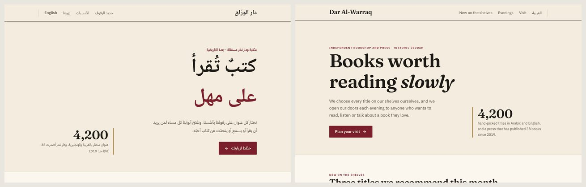
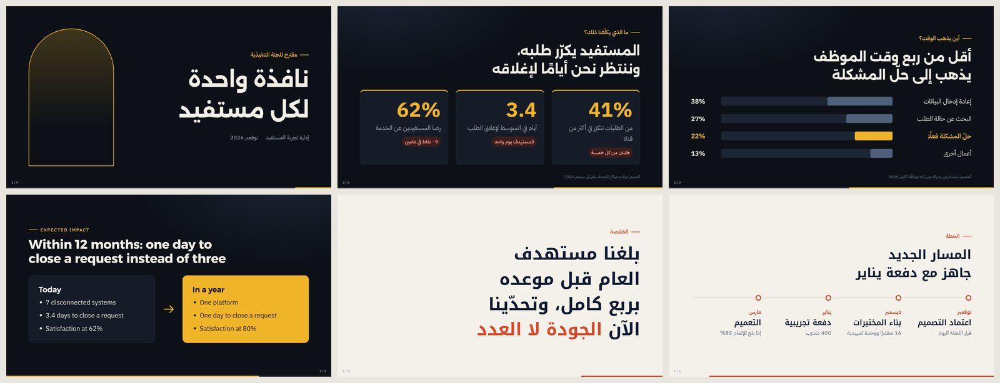

<div dir="rtl" lang="ar">

# بيان · Bayan

**مهارات لـ Claude تبدأ من العربية: مواقع ثنائية اللغة، وعروض تقديمية بصيغة HTML، وتدقيق دعم الاتجاه من اليمين إلى اليسار، وصياغة نصوص الواجهات، ومع كل مهارة أداة تتحقق من سلامة الناتج.**

[English](README.md) · [الأمثلة](examples/) · [لماذا هذا المشروع؟](docs/OPPORTUNITY.md) · [خارطة الطريق](ROADMAP.md)



حين تطلب من نموذج ذكاء اصطناعي صفحة عربية، تحصل غالبًا على صفحة إنجليزية معكوسة: أرقام هواتف مقلوبة، وعناوين تباعدت حروفها حتى انفصلت، وأسهم تشير إلى الخلف، ونصوص تبدو مترجمة. النموذج يعرف القواعد، لكن ينقصه أمران: طريقة عمل تطبّقها، ووسيلة للتحقق من النتيجة.

«بيان» يقدّم الأمرين: أربع مهارات وفق معيار [Agent Skills](https://agentskills.io) المفتوح، وأداتان بلغة بايثون لا تحتاجان إلى أي مكتبات: مدقّق فيه 30 قاعدة للاتجاه والنص ثنائي الاتجاه والخطوط وتنسيقات CSS، وفاحص يضمن تطابق المحتوى العربي والإنجليزي.

## المهارات

| المهارة | الاستخدام | المحتوى |
|---|---|---|
| <bdi dir="ltr">`arabic-rtl-web`</bdi> | المواقع وصفحات الهبوط وواجهات الويب العربية وثنائية اللغة | قالب ثنائي اللغة في ملف واحد، وخمسة مراجع |
| <bdi dir="ltr">`arabic-html-slides`</bdi> | عروض تقديمية جاهزة للعرض بالعربية أو الإنجليزية أو بكلتيهما | محرّك عرض يراعي اتجاه القراءة، ومنهج لبناء القصة |
| <bdi dir="ltr">`rtl-audit`</bdi> | اكتشاف مشكلات الاتجاه في المواقع والتطبيقات القائمة وإصلاحها | فهرس القواعد، وحلول جاهزة، وقائمة مراجعة يدوية، وقالب تقرير |
| <bdi dir="ltr">`arabic-ux-writing`</bdi> | صياغة نصوص الواجهات وتعريبها ومراجعتها | دليل أسلوب، ومسرد فيه أكثر من 200 مصطلح، وأنماط، وأخطاء شائعة |

كل مهارة مستقلة بنفسها: ثبّت واحدة أو الأربع معًا.

## التثبيت

**في Claude Code (المهارات الأربع)**

<div dir="ltr">

```
/plugin marketplace add malenezi/bayan
/plugin install bayan@bayan
```

</div>

**مهارة واحدة**

<div dir="ltr">

```bash
git clone https://github.com/malenezi/bayan
cp -r bayan/skills/arabic-rtl-web ~/.claude/skills/
```

</div>

**في تطبيقات Claude**

شغّل <bdi dir="ltr">`python tools/build_dist.py`</bdi> ثم ارفع الملف المضغوط الذي تريده من مجلد <bdi dir="ltr">`dist/`</bdi> بوصفه مهارة مخصّصة من إعدادات Claude.

## الاستخدام

اطلب ما تريد بلغتك، وسيختار Claude المهارة المناسبة:

- «ابنِ صفحة هبوط لمنصتنا بالعربية مع زر للتبديل إلى الإنجليزية، في ملف HTML واحد.»
- «أحتاج إلى عرض تنفيذي من 15 دقيقة للجنة التنفيذية، بالعربية مع إمكانية التحويل إلى الإنجليزية.»
- «تطبيقنا يحتاج إلى دعم العربية. دقّق مجلد <bdi dir="ltr">`src/`</bdi> وأخبرني بما ينبغي تغييره.»
- «راجع ملف النصوص العربية وقارنه بالإنجليزي. الجمهور خليجي والأسلوب مهني ودود.»

في [مجلد الأمثلة](examples/) أربعة نماذج كاملة، مع الطلب والناتج وأوامر التحقق.



## الأداتان

تعملان دون Claude أيضًا، من سطر الأوامر أو ضمن التكامل المستمر:

<div dir="ltr">

```bash
python shared/scripts/bidi_lint.py site/
python shared/scripts/bidi_lint.py deck.html --profile deck
python shared/scripts/i18n_parity.py --json ar.json en.json
```

</div>

يكتشف المدقّق، من جملة ما يكتشف: غياب <bdi dir="ltr">`lang`</bdi> و<bdi dir="ltr">`dir`</bdi>، وأرقام الهواتف والتواريخ غير المعزولة، وخصائص CSS المرتبطة باليسار واليمين، وتباعد الحروف والخط المائل في النص العربي، وعلامات الترقيم اللاتينية بعد الكلام العربي، والخلط بين نظامَي الأرقام.

## مستودعات ذات صلة

«بيان» مستودع مستقل. ولصاحبه مستودعان شقيقان يستخدمانه:

- [الأكاديمية السعودية لريادة الأعمال بالذكاء الاصطناعي الوكيلي](https://github.com/malenezi/saudi-agentic-ai-entrepreneurship-academy): منهج عربي أولاً لرواد الأعمال. [تمارين مختبرها](https://github.com/malenezi/saudi-agentic-ai-entrepreneurship-academy/tree/main/05-agentic-ai-lab/exercises) تستخدم هذه المهارات والمدققات لرسائل الوكيل وصفحة هبوط التجربة والعرض الاستثماري وتدقيق الاتجاه ولوحة قيادة ثنائية اللغة. انظر [صفحة المستودعات المرافقة](https://github.com/malenezi/saudi-agentic-ai-entrepreneurship-academy/blob/main/07-resources/companion-repositories.md).
- [ريادة](https://github.com/malenezi/riyada): مهارات وملفات سياق وقوالب لمؤسس يبني ويشغّل منشأة بالوكلاء. «ريادة» تخطط التموضع والعرض، و«بيان» يبني الصفحة والعرض.

## المساهمة

أثمن ما يمكن أن تقدّمه تصحيح من أهل اللغة أو من مهندسي الواجهات: مصطلح غير دقيق، أو تنبيه في غير محلّه، أو قاعدة ناقصة. التفاصيل في [دليل المساهمة](CONTRIBUTING.md).

## الترخيص

رخصة MIT.

</div>
