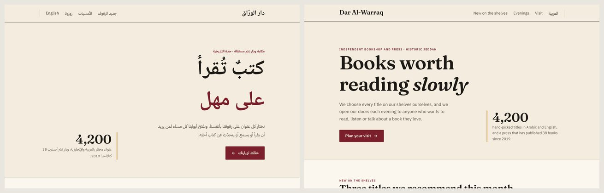
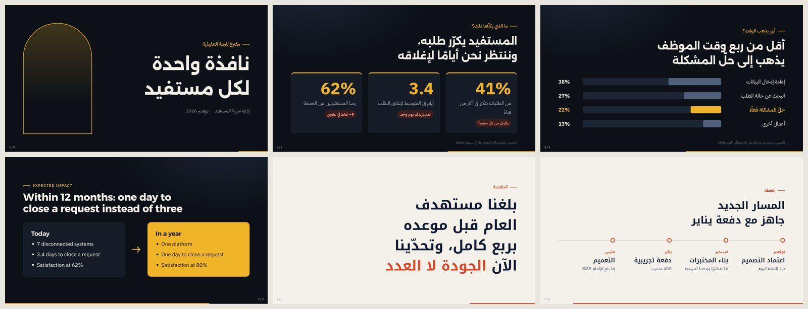

# Bayan · بيان

**Arabic-first skills for Claude: bilingual websites, cinematic HTML decks, RTL audits and Arabic UX writing, each with a linter that proves the output is right.**

[العربية](README.ar.md) · [Examples](examples/) · [Why this exists](docs/OPPORTUNITY.md) · [Validation](VALIDATION.md) · [Roadmap](ROADMAP.md)



Ask a model for an Arabic page and you usually get an English page, mirrored: phone numbers reversed, headings letter-spaced until the letters come apart, arrows pointing backwards, translated-sounding copy. The model knows the rules. What it lacks is a workflow that applies them and a way to check the result.

Bayan supplies both. Four [Agent Skills](https://agentskills.io) teach the workflow, and two dependency-free Python scripts check the output: 30 lint rules for direction, bidirectional text, typography and CSS, plus a parity checker that keeps Arabic and English in step.

## The skills

| Skill | Use it for | Ships with |
|---|---|---|
| [`arabic-rtl-web`](skills/arabic-rtl-web/) | Arabic and bilingual websites, landing pages, web UI | Single-file bilingual starter, 5 reference guides |
| [`arabic-html-slides`](skills/arabic-html-slides/) | Presentation-ready HTML decks in Arabic, English or both | Deck engine (direction-aware keys, steps, print to PDF), storyline method |
| [`rtl-audit`](skills/rtl-audit/) | Finding and fixing RTL defects in existing sites and codebases | Rule catalogue, fix recipes, manual checklist, report template |
| [`arabic-ux-writing`](skills/arabic-ux-writing/) | Interface text, transcreation, reviewing Arabic strings | Style guide, glossary of more than 200 terms, patterns, common-mistakes list |

Each skill is self-contained: install one or all four. Every skill bundles the same two scripts under `scripts/`.

## Install

**Claude Code (plugin, all four skills)**

```
/plugin marketplace add malenezi/bayan
/plugin install bayan@bayan
```

**Claude Code (single skill, no plugin)**

```bash
git clone https://github.com/malenezi/bayan
cp -r bayan/skills/arabic-rtl-web ~/.claude/skills/        # personal
cp -r bayan/skills/arabic-rtl-web .claude/skills/          # or per project
```

**Claude apps (web, desktop, mobile)**

Run `python tools/build_dist.py`, then upload the zip you want from `dist/` as a custom skill in Claude's settings. Skills need code execution enabled to run the bundled scripts; the guidance works without it.

**Other agents**

The skills follow the open Agent Skills format, so any agent that reads `SKILL.md` folders can use them.

No dependencies beyond Python 3.9+ for the scripts.

## Use

Just ask. Claude loads the right skill from the request.

**1. A bilingual site**

> Build a landing page for our transit-planning platform. Arabic first with an English toggle, one self-contained HTML file.

Claude picks the single-file pattern, starts from the bilingual starter, writes both languages natively, then runs `bidi_lint.py` and `i18n_parity.py` and fixes what they report. See [example 01](examples/01-bilingual-site/) for the two-page variant.

**2. An executive deck**

> I present to the executive committee next week: 15 minutes, Arabic with an English switch, asking for approval to merge our seven service channels. Here are the numbers…

Claude writes the storyline first (titles as sentences, the request on the last slide), builds on the deck engine, and checks it with `--profile deck`. Result: [example 02](examples/02-executive-deck/deck.html). Press `L` to switch language; in Arabic the left arrow advances.



**3. An audit of existing code**

> Our React app needs Arabic support. Audit `src/` and tell me what has to change.

Claude scans, triages, reviews what a scanner cannot see, fixes in dependency order and writes a report. [Example 03](examples/03-rtl-audit/) takes a page from 31 findings to zero.

**4. A strings review**

> Review `locales/ar.json` against `en.json`. Gulf audience, professional but friendly.

Claude fixes terminology first, rewrites calques, checks placeholders and missing keys mechanically, and returns a before/after table. See [example 04](examples/04-ui-strings/).

## The tools on their own

The scripts work without Claude, in CI or from a terminal.

```bash
python shared/scripts/bidi_lint.py site/                       # HTML, CSS, JSX/TSX/Vue class names, JSON, Markdown
python shared/scripts/bidi_lint.py deck.html --profile deck    # adds presentation checks
python shared/scripts/bidi_lint.py src/ --format md > audit.md # report grouped by rule
python shared/scripts/bidi_lint.py src/ --strict               # fail the build on warnings
python shared/scripts/bidi_lint.py --list-rules

python shared/scripts/i18n_parity.py page.html                         # data-lang pairs in one file
python shared/scripts/i18n_parity.py --json ar.json en.json            # message catalogues
python shared/scripts/i18n_parity.py --pages ar/index.html en/index.html
```

```
before.html
    41:22  warning BD107  phone number '+966 11 555 0199' is not isolated
           | للاستفسار اتصل على +966 11 555 0199 أو راسلنا
           > Wrap it: <bdi dir="ltr">...</bdi> (or <span dir="ltr">). For ranges, words are clearer: من 10 إلى 20.
```

Rule catalogue with before/after for every rule: [rule-catalog.md](skills/rtl-audit/references/rule-catalog.md).

What the linter catches, in brief:

- **Structure**: missing or mismatched `lang`/`dir`, language switches without `dir`, LTR inputs that inherit RTL
- **Bidirectional text**: unisolated phone numbers, signed numbers, ranges, dashed dates, URLs, handles, `C++`; legacy bidi control characters
- **CSS**: physical properties and alignment, `direction` in CSS, letter-spacing and italics reaching Arabic, tight line-height, font stacks with no Arabic face, transforms that do not mirror, bare `:lang()` rules that break inheritance
- **Utility classes**: physical Tailwind classes (`ml-4`, `text-left`, `rounded-l`)
- **Content**: Latin punctuation after Arabic, mixed digit systems, tatweel stretching, backwards arrows
- **Decks**: reduced-motion support, print styles, keyboard navigation, headings, text-heavy slides

It exempts what is legitimately physical: symmetric pairs, centering, rules under a `[dir]` selector, values using CSS variables. Silence anything else in place with `bidi-lint-ignore` and a reason.

## Repository layout

```
skills/                 the four skills (SKILL.md, references/, assets/, scripts/)
shared/scripts/         source of truth for bidi_lint.py and i18n_parity.py
examples/               four end-to-end runs with prompts and outputs
tests/                  74 unit and repository tests
tools/                  validate_skills.py, sync_shared.py, gen_rule_catalog.py, build_dist.py
.claude-plugin/         plugin and marketplace manifests for Claude Code
docs/                   opportunity analysis, images
```

## Quality

```bash
make check     # tests + spec validation + sync check + lint of every template and example
```

- Every skill passes `skills-ref validate` and the repository's own 21-point check against the Agent Skills specification. Details: [VALIDATION.md](VALIDATION.md).
- Every template and example passes the linter and the parity checker in CI.
- Rendering claims in the bidi reference were verified in Chromium, not taken from memory.

## Contributing

Corrections from native speakers and RTL engineers are the most valuable contribution: a wrong term, a false positive, a missing rule. See [CONTRIBUTING.md](CONTRIBUTING.md). Hebrew, Persian and Urdu guidance is on the [roadmap](ROADMAP.md).

## Licence

MIT. See [LICENSE](LICENSE). Templates load fonts from Google Fonts under their own open licences.
